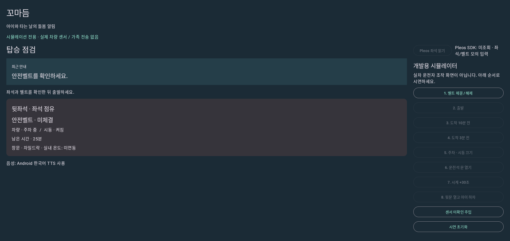
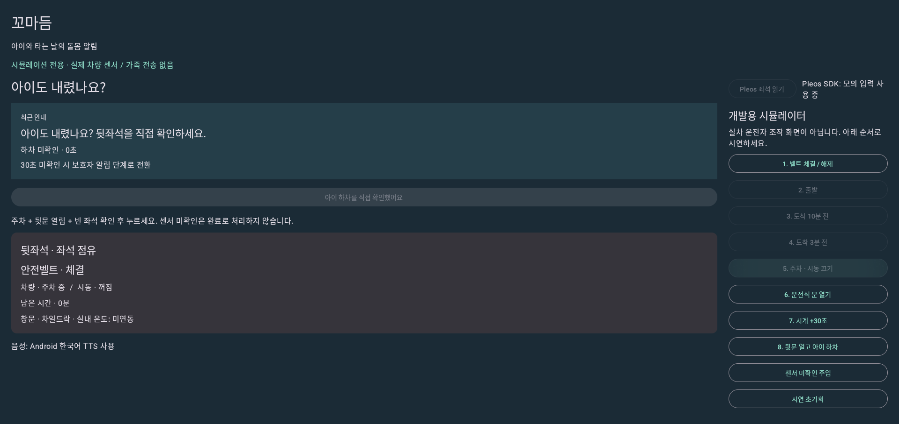
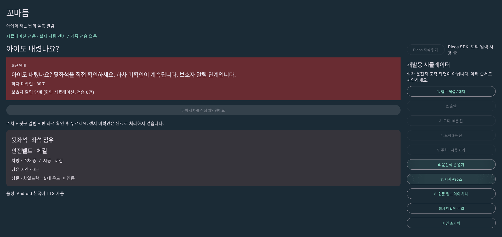
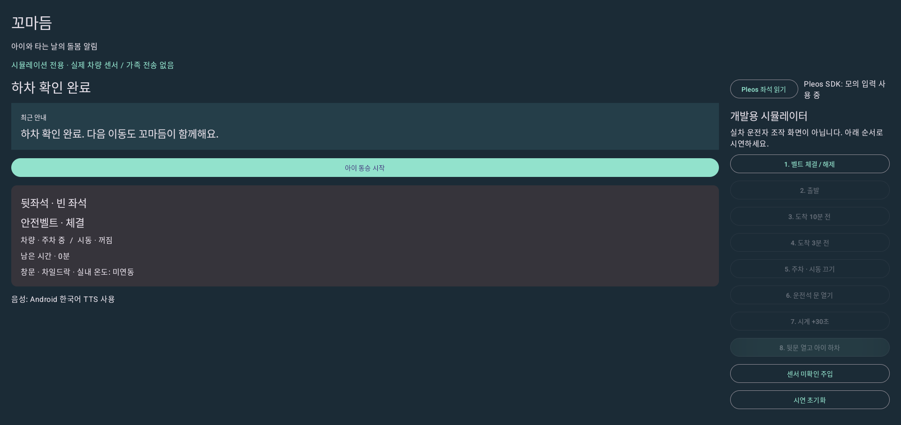

# 꼬마듬 — 아이와 타는 날의 돌봄 알림

**한 줄 소개:** 아이를 태운 날, 탑승 점검 → 이동 중 도착 준비 안내 → 도착 후 뒷좌석 재확인까지
운전자가 고개를 돌리지 않아도 되도록 차량 상태와 남은 시간을 읽어 챙겨 주는 차량용(AAOS) 돌봄 알림 앱.

2026 현대자동차그룹 차량용 앱 개발 공모전 개인 참가 출품작의 **Increment 1 시제품**이다.
상태 전이·경고·중복 억제·직접 하차 확인은 실제 코드로 동작하고, 좌석·벨트·문·주차·시동·내비 ETA 같은
차량 신호는 화면 오른쪽 **개발용 시뮬레이터**가 넣는 모의 입력이다. 앱 화면에 이 구분이 항상 표시된다.
별도의 **Pleos 좌석 읽기** 버튼은 공개 Pleos Vehicle SDK 2.3.2를 실제로 호출해 후석 좌측 점유·벨트를 1회 조회한다.
Vehicle Service가 없는 에뮬레이터에서는 "연결 불가"를 표시하고 모의 시연을 유지한다.

> 이 앱은 차량 기본 후석 승객 알림 장치를 대체하지 않는 보호자 확인 보조 도구다.
> 점유 센서는 아이와 짐을 구분하지 못하며, 차량 벨트 체결은 카시트 하네스 체결을 뜻하지 않는다.

## APK 위치

| 항목 | 값 |
|---|---|
| release APK | [`apk/leeeo_꼬마듬_release.apk`](apk/) |
| 패키지 / 버전 | `app.leeeo.gachita` / versionName 0.1.0, versionCode 1 |
| minSdk / targetSdk / compileSdk | 28 / 34 / 35 |
| 서명 | APK Signature Scheme v3, RSA 3072, 인증서 `CN=leeeo, O=leeeo` |
| 인증서 SHA-256 | `7af162946c429e96e8599f6d0d765ae79e2536ac6de7b82eae86b0a0d577b17f` |
| APK 파일 SHA-256 | `c86fc42e3bd5082d633ad3d8fd3e824072f413196ad66ab066eb9cf6dbf84b08` (22,688,310바이트) |

패키지 ID `app.leeeo.gachita`는 초기 가칭 시절의 내부 식별자이며 빌드 호환을 위해 유지했다. 사용자에게 보이는 이름은 꼬마듬이다.

## 실행 방법

### 1. APK만 실행

Android Automotive(API 28 이상, 권장 API 34) 에뮬레이터를 켠 뒤:

```powershell
adb install -r "apk/leeeo_꼬마듬_release.apk"
adb shell am start -n app.leeeo.gachita/.MainActivity
```

### 2. 시연 순서 (시나리오 1: 평일 아침 등원)

1. **Pleos 좌석 읽기**(선택) — 실제 SDK 호출. Pleos Vehicle Service가 없으면 "연결 불가" 표시.
2. **아이 동승 시작** — 탑승 점검. 벨트 미체결 경고가 나온다.
3. 시뮬레이터 **1. 벨트 체결 / 해제 → 2. 출발**.
4. **3. 도착 10분 전 → 4. 도착 3분 전** — 아이 깨우기, 준비물 안내(각 1회, 한국어 TTS 엔진이 있으면 음성).
5. **5. 주차 · 시동 끄기 → 6. 운전석 문 열기** — "아이도 내렸나요?" 경고가 남는다.
6. **7. 시계 +30초** — 30초 미확인 시 보호자 알림 단계(빨간 배경). 실제 전송은 하지 않는다.
7. **8. 뒷문 열고 아이 하차 → 아이 하차를 직접 확인했어요** — 완료.
8. **시연 초기화**로 반복. **센서 미확인 주입**으로 불명확한 값을 안전 확인으로 오인하지 않는지 볼 수 있다.

가로 차량 화면은 두 열, 좁은 화면은 세로 스크롤이다. 테마는 짙은 색 한 가지다.

### 3. 소스에서 빌드

필요 도구: JDK 17, Android SDK Platform 35 / Build Tools 35.0.0, Gradle Wrapper 8.14(포함).
`local.properties`에 자신의 SDK 경로를 적는다. 이 파일은 Git에 넣지 않는다.

```properties
sdk.dir=C\:\\Users\\<사용자>\\AppData\\Local\\Android\\Sdk
```

```powershell
.\gradlew.bat :domain:test :app:assembleDebug :app:lintDebug
.\gradlew.bat :app:assembleRelease   # 서명 전 app-release-unsigned.apk
```

release 서명은 소유자 개인 키로만 한다. 키는 저장소에 없으며, 서명 절차는 `tools/sign-release.mjs`에 있다.
macOS/Linux는 `./gradlew`를 사용한다.

## 테스트 환경 및 필요한 설정

| 항목 | 값 |
|---|---|
| 에뮬레이터 이미지 | Google Android Automotive **API 34** `system-images;android-34-ext9;android-automotive;x86_64` rev 5 (빌드 `UAA1.250512.001`) |
| AVD | `automotive_1080p_landscape` 기반 |
| 화면 규격 | 물리 1080×600 px / 120 dpi, 시연·캡처는 `wm size 1920x1080`, `wm density 160`(가로) 및 `800x1280`, `240`(좁은 화면) |
| Pleos Connect Emulator | **미사용**. 공식 Pleos Connect Emulator 2.1.0(API 34) 이미지는 확인했으나 이번 검증은 Google AAOS 이미지에서 수행했다 |
| Pleos SDK | `ai.pleos.playground:Vehicle:2.3.2` (공개 Maven, Vehicle Service 최소 2.3.13 요구) |
| 권한 | `pleos.car.permission.CAR_SEATS`(normal, 좌석 읽기)와 SDK가 병합하는 `VEHICLE_BINDING`. 인터넷·위치·마이크 권한 없음 |
| 음성 | Android 한국어 TTS 엔진이 있으면 안내를 발화. 녹화는 무음(`-no-audio`) |

필요한 설정은 없다. 서버·계정·API 키를 쓰지 않으며 네트워크 통신을 하지 않는다.

검증 명령:

```powershell
.\gradlew.bat --no-daemon :domain:test :app:assembleDebug :app:assembleDebugAndroidTest :app:lintDebug
$env:ANDROID_SERIAL = "emulator-5580"
.\gradlew.bat --no-daemon :app:connectedDebugAndroidTest
```

- JVM 테스트 17개: 세션 상태·센서 미확인·알림 임계값·하차 확인 규칙.
- 기기 테스트 3개: 전체 흐름, 미확인 좌석 확인 차단, Activity 재생성 복원. 화면 캡처를 함께 남긴다.
- 결과와 도구 버전은 [검증 기록](docs/VERIFICATION.md)에 있다.

## 화면

| 탑승 점검 | 도착 후 재확인 | 30초 미확인 강화 | 완료 |
|---|---|---|---|
|  |  |  |  |

좁은 화면 캡처는 `docs/screenshots/narrow/`에 있다.

## 구조와 제한

- `domain/`: 순수 Kotlin 규칙(`RideSession`), 센서 입력 경계, 모의 센서, 단위 테스트.
- `app/`: Compose UI, Android TTS, 개발용 센서 패널, Pleos 진단 어댑터, 화면 테스트.
- [설계와 기획서 대응](docs/DESIGN.md), [공개 플랫폼 조사](docs/PLATFORM.md)

구현하지 않은 것: 실차 센서 지속 구독, 내비 ETA 연동, 보호자 휴대폰 알림, 가족 지도·계정, 음성 질의응답(STT),
창문·차일드락·온도. 시동 OFF 이후 백그라운드 실행을 보장하지 않으며, 주행 허용(`distractionOptimized`) 앱이 아니라
정차 상태의 시연 앱이다. 회사 코드나 다른 서비스 코드를 가져오지 않고 이 저장소에서 새로 작성했다.
